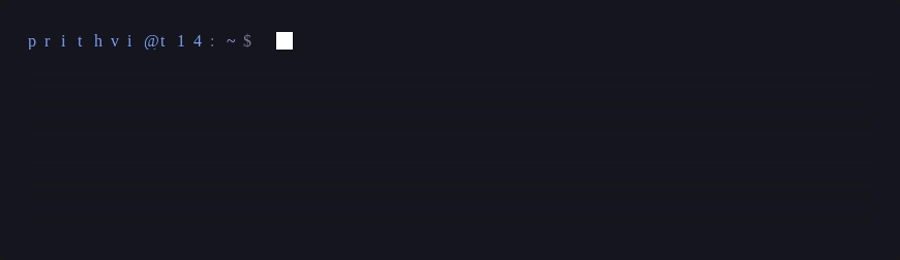

  

  <a href="https://www.linkedin.com/in/prithvi-kaushik/">LinkedIn</a> •
  <a href="mailto:prithvi.k314@gmail.com">Email</a> •
  <a href="https://www.instagram.com/reallyprithvi">Drums</a>

---

## Featured Work

### [KERB](https://github.com/PrithviKaushik/kerb)
Human-in-the-loop computer vision system that turns motorsport footage into structured evidence for track-limit steward review (built in 24h at TrackShift 2026).

 
▶ Click to watch the demo

- Built a spatio-temporal pipeline using fine-tuned **YOLO11n**, **ByteTrack**, calibrated boundary geometry, and temporal aggregation to classify incidents as `VIOLATION_CANDIDATE`, `NO_VIOLATION`, or `UNCERTAIN`
- Fine-tuned YOLO11n on camera-specific race footage (0.035 → 0.995 mAP@50 on a 10-image held-out split from the target camera view) with ~12.1 FPS end-to-end tracking on CPU-only hardware
- Served evidence timelines and review workflows via **FastAPI** and **Next.js**

### [daybreak-gp](https://github.com/PrithviKaushik/daybreak-gp) *(Work in Progress)*
Controlled empirical study comparing stationary vs. non-stationary Gaussian Processes for hourly solar PV forecasting on the **SOLETE** dataset (10,968 hourly observations).

- Implementing a 1D non-stationary **Gibbs** kernel (Paciorek & Schervish, 2003) in **GPyTorch** with a neural-network-parameterized length scale $\ell(t)$ optimized via marginal likelihood
- Comparing **RBF** vs. **Gibbs** (and 24-hour **Periodic** compositions) across 24h/48h interpolation and future extrapolation, evaluating both point error (**RMSE**, **MAE**) and uncertainty calibration (**NLPD**, 95% interval coverage)
- Building a reproducible, config-driven pipeline with unit tests, artifact tracking, and a planned **FastAPI** inference service

---

## Stack

**Machine Learning & Data**
 

**Backend & Deployment**
 

**Systems & Tooling**
 

Previously shipped cross-platform apps (Flutter, Dart, Firebase)—retired from mobile, kept the habit of writing tests.

---

## Current Focus

- **Probabilistic forecasting:** Evaluating kernel compositions (RBF, Periodic, Gibbs) and uncertainty calibration on solar/weather time-series in `daybreak-gp`
- **Production ML systems:** Moving models past notebooks—reproducible evaluation, FastAPI inference services, and containerized deployment
- **Applied LLM systems:** Building reliable, evaluation-driven LLM pipelines and structured tool-use workflows
- **Open source:** Contributing to Python infrastructure and ML tooling repositories

---

## GitHub Activity

  
  

---

## Off the Clock

- **Drums:** Playing kit and posting covers on [Instagram](https://www.instagram.com/reallyprithvi)
- **Boxing:** Training fundamentals, bag work, and conditioning
- **Linux:** Occasionally breaking my Sway config at 2 AM and pretending it was planned

---

  <i>"The goal isn't to prove a fancier model wins—it's to know when it's actually worth the complexity."</i>

